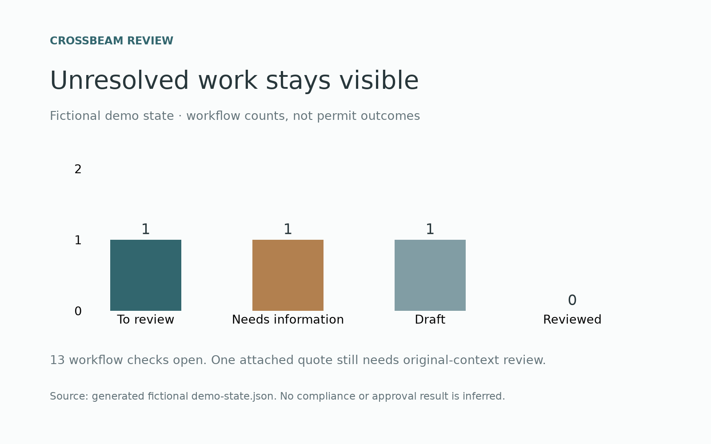

# CrossBeam Review

<!-- project-navigation:start -->
[Architecture](local_review/docs/ARCHITECTURE.md) · [Design choices](local_review/docs/DECISIONS.md) · [Portfolio](local_review/docs/PORTFOLIO.md) · [Demo and deployment](local_review/docs/DEPLOYMENT.md) · [Recorded demo](https://crossbeam-review.pages.dev)
<!-- project-navigation:end -->



*Generated result figure. Existing project evidence; this is not a browser screenshot.*

A local evidence-linked workspace for preparing ADU correction-response drafts. Keep each correction, source page, response, missing-information question, and human review decision together.

An attributed extension of [CrossBeam](https://github.com/mikeOnBreeze/cc-crossbeam), by **Mike Brown**, under its original MIT license. The original cloud/AI system is retained; this extension adds a separate local workflow under `local_review/`. It does not claim the original hackathon win or production city pilots.

[Portfolio case study](local_review/docs/PORTFOLIO.md) · [Workflow and limitations](local_review/docs/METHODOLOGY.md) · [Improvements](local_review/docs/IMPROVEMENTS.md) · [Original setup](UPSTREAM_README.md)

## Start locally

Python 3.11 or newer:

```sh
python3 -m venv .venv
.venv/bin/pip install -r local_review/requirements.txt
.venv/bin/python -m local_review.server --demo
```

Open **http://127.0.0.1:8773**. The example uses fictional plans and a fictional letter. No real city, address, property, or permit is represented. Stop with Ctrl+C.

On the prepared Desktop checkout:

```sh
cd ~/Desktop/crossbeam-review
./start-local-review.sh --demo
```

Use `--port 8774` for another port or `--data /path/to/private/review.db` for another local database. Omit `--demo` to start without adding the example. The UI can create projects and load the fictional example later.

## Workflow

1. Create a project with its jurisdiction, category, and declared area. These are user declarations, not an eligibility check.
2. Import plans and a correction letter as PDF or UTF-8 text. Letter extraction produces **candidate** items; inspect the original for omissions and incorrect splitting.
3. Select a correction. Edit working wording if needed; the original extract stays recorded. Draft a response and record open questions.
4. Search plan/reference text, inspect the source page, and attach an exact quote. The app checks text provenance; you check the original context and drawings.
5. Mark evidence checked and explicitly confirm human review before setting an item to reviewed. Unanswered questions, missing responses, or unchecked evidence block that state.
6. Complete document-inspection declarations and applicable checklist tasks with a review basis. Export a **draft** PDF, Markdown, or research JSON package.

Exports remain drafts even when local workflow checks are complete. The tool does not determine permit approval, legal compliance, engineering adequacy, or whether a signature/dimension is valid.

## Delivered improvements

- Immutable source bytes, document/page SHA-256 hashes, exact whitespace-normalized quote matching, and project-scoped evidence.
- Editable candidate wording with retained original text and an append-only local audit trail.
- Review notes and explicit missing-information states; a checked quote does not become an automated compliance claim.
- Optimistic revision checks to prevent stale updates. Unsaved response drafts survive evidence actions and rejected saves.
- A category-scoped general checklist, source-entry links, and clear document-inspection declarations.
- Local PDF/text ingestion and draft-only PDF/Markdown/JSON exports. No model key, cloud account, paid call, or file transmission is needed for this extension.

## Limits and source freshness

PDF support is text extraction, **not OCR or blueprint vision**. Blank/scanned pages are flagged. Drawings, stamps, signatures, dimensions, extraction completeness, and legal applicability require independent human review. See [pypdf's extraction limitations](https://pypdf.readthedocs.io/en/stable/user/extract-text.html).

The source list links official [California HCD ADU resources](https://www.hcd.ca.gov/building-standards/adu), the [HCD handbook page](https://www.hcd.ca.gov/building-standards/adu/handbook), and example Placentia resources. Links were checked November 27, 2026. The app does not fetch, interpret, or apply law; city sources apply only to their jurisdiction. Do not treat the general task list as a complete current municipal checklist.

The original repository's AI plan-reading and cloud orchestration remain available under [UPSTREAM_README.md](UPSTREAM_README.md). Their credentials, services, vision results, and production behavior were not exercised for this extension.

## Verification

```sh
.venv/bin/python -m unittest discover -s local_review/tests -v
npm ci --prefix local_review
CROSSBEAM_PYTHON="$PWD/.venv/bin/python" npm --prefix local_review test
node --check local_review/web/app.js
```

16 Python tests and three JavaScript DOM integration tests pass. The JavaScript tests operate the actual UI handlers against a real local Python HTTP server, covering review confirmation, draft preservation, quote candidates, inert text rendering, document inspection, checklist saves, and PDF export. The original cloud application and its dependencies were not retested.

Generated fictional PDFs were rendered and visually inspected. Browser layout QA was unavailable; DOM tests are not browser screenshots or accessibility certification.

## Storage and boundaries

Original PDFs, extracted pages, responses, notes, and events stay in ignored `runtime/local-review.db`. This database is a local sensitive-document store without encryption at rest or a user-account system. The app binds to loopback, validates Host and write origins, serves fixed assets, and scopes document access by project. Do not expose it as a public server.

Limits: 10 projects, 10 documents per project, 100 pages and 8 MB per PDF, 500,000 extracted characters per document, 100 items per project, and eight evidence quotes per item. Complex PDF streams can be rejected and may need splitting. Text imports retain explicit unverified-source labels.

The audit is append-only through the application, not cryptographically tamper-proof. The UI/research JSON includes the latest 100 events; the SQLite database retains the full local history. JSON exports are review snapshots, not full original-file backups.

## Attribution

Original CrossBeam: Mike Brown, https://github.com/mikeOnBreeze/cc-crossbeam, base `05a38effc99a2e1ffc3a3989ddbdcbc112121492`.

Local review extension and fictional examples: Victor Hui. Original MIT notices are preserved. Real upstream permit documents retain their original attribution/permissions; this extension's new demo and portfolio use only newly generated fictional material. Cloud deployment is retained as a manual workflow; the fork's automatic CI covers the local extension.
