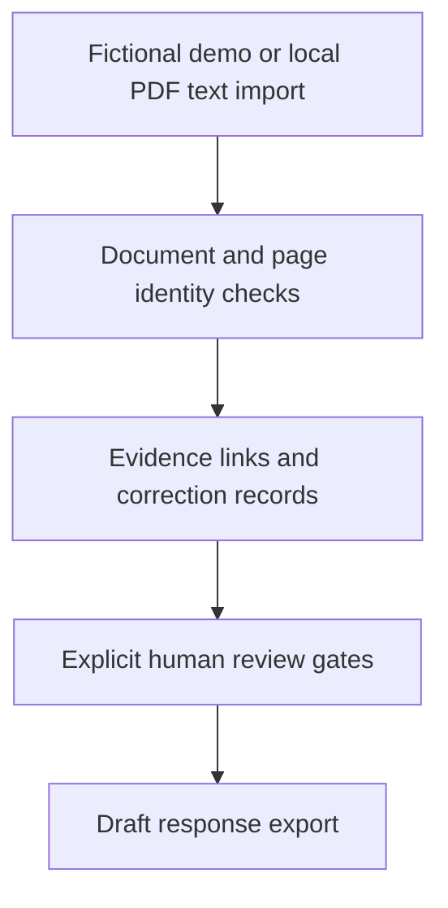

# Architecture

Evidence-linked local correction review with source-page quotes, human gates, and draft response exports.

## Data flow

## Source map

- [local_review/documents.py](../documents.py)
- [local_review/store.py](../store.py)
- [local_review/export.py](../export.py)
- [local_review/server.py](../server.py)
- [local_review/web/app.js](../web/app.js)

## Evidence and boundaries

Contribution is the local review workflow; Mike Brown owns the original CrossBeam work. MIT fork extension of Mike Brown’s CrossBeam; examples are fictional and exports remain drafts.

See [setup and recorded results](../../README.md), [design choices](DECISIONS.md), and [portfolio notes](PORTFOLIO.md).
