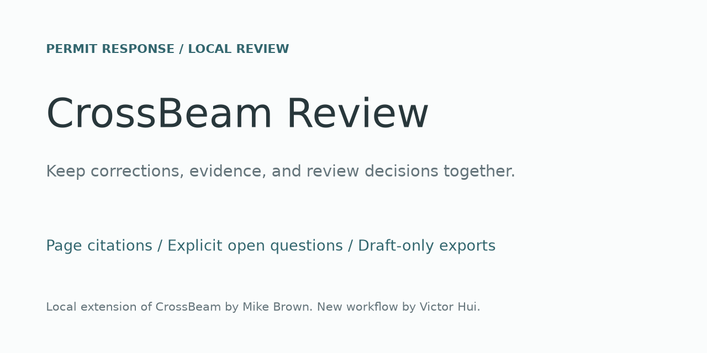
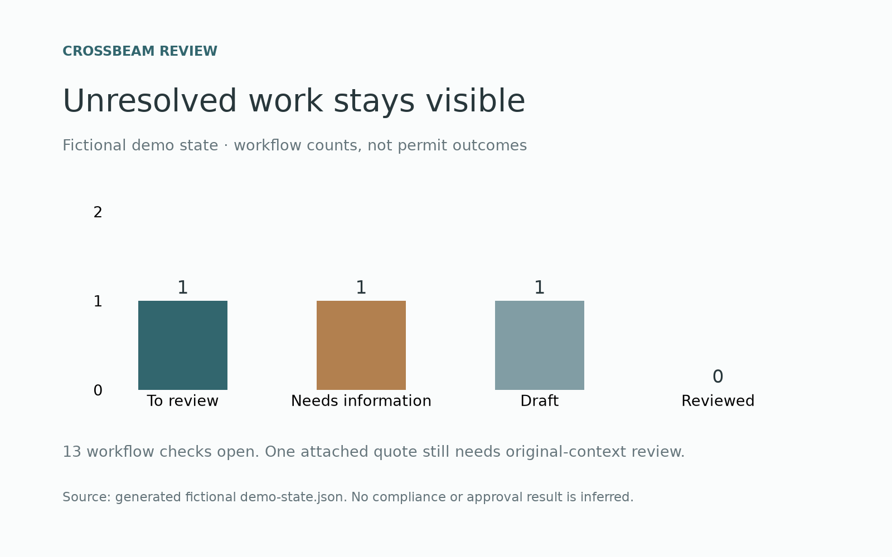
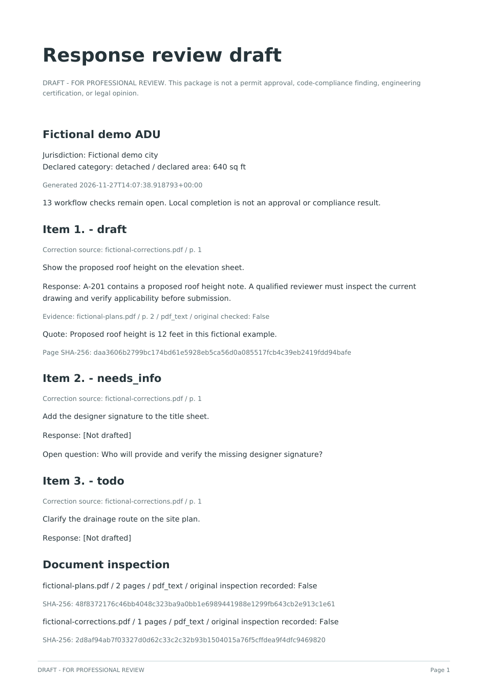

# CrossBeam Review

A local evidence-linked workflow for preparing permit-correction response drafts.

[Repository](https://github.com/victorhuii/crossbeam-review) · [Original CrossBeam by Mike Brown](https://github.com/mikeOnBreeze/cc-crossbeam) · [Methodology](METHODOLOGY.md) · [Changes and recommendations](IMPROVEMENTS.md)

## Project card

**Description:** Organize ADU correction items, inspect page evidence, record open questions, and prepare traceable response drafts. The local workspace preserves original documents and review history while requiring explicit human checks before marking work reviewed.

**Stack:** Python · SQLite · PDF extraction/export · JavaScript · Evidence provenance

**Cover:** [1280 × 640 PNG](assets/cover.png) · [SVG](assets/cover.svg)

## Contribution and attribution

This is an extension of Mike Brown's MIT-licensed CrossBeam. The original author built the retained model-assisted plan-review application and cloud architecture. My contribution is the separate local review package: immutable document ingestion, page-quote matching, editable working corrections with retained originals, human review gates, checklist bases, audit history, draft exports, and tests.

The project does not claim the original hackathon award, city pilots, or new validation of the original AI system. New examples and portfolio materials are fictional and contain no real client plans.

## Problem

A convincing response is difficult to trust when its evidence, source page, unresolved questions, and review decisions are scattered. Text extraction can also be mistaken for proof that a drawing or legal requirement was checked. The local workflow makes those distinctions explicit and keeps the draft reviewable without paid services.

## A deliberately incomplete example

The fictional demo has three correction items: one response draft, one missing-information question, and one item still to review. One exact page quote is attached but remains unchecked against the original context. Document inspection and checklist work are still open.

[PNG](assets/review-state.png) · [SVG](assets/review-state.svg). Counts come from [the saved fictional demo state](../examples/demo-state.json), not production projects or an accuracy benchmark. Local completion is never treated as permit approval.

## A traceable draft package

The PDF export keeps the correction, source filename/page, response, open question, evidence quote, and page hash together. It records unchecked evidence and incomplete document inspection rather than hiding them.

This is a rendered page of an actual generated PDF, not a browser screenshot. The [fictional two-page response draft](../examples/fictional-response-draft.pdf) and [Markdown version](../examples/fictional-response-draft.md) are included. [Page two preview](assets/response-draft-page-2.png) shows the human checklist and official research entry points.

## Engineering decisions

- Original PDF bytes and extracted page hashes remain immutable. Exact whitespace-normalized quote matching checks text provenance, not semantic/legal correctness.
- Human “checked” flags and explicit confirmation control reviewed state. Missing evidence, open questions, or unverified reference applicability block it.
- Working correction wording can be edited without overwriting the original extract or its source identity.
- Item/checklist revisions reject stale writes. Unsaved response drafts survive evidence actions and failed validation.
- The loopback server scopes documents by project and keeps source files in an ignored local SQLite database.
- PDF, Markdown, and JSON exports remain review drafts; there is no automatic submission or external file transmission.

## Demo

1. Run `./start-local-review.sh --demo` and open http://127.0.0.1:8773.
2. Select the fictional roof-height correction. Read its attached page quote and original source text.
3. Edit the response, then record the evidence check. The unfinished response stays in the form.
4. Try to mark reviewed without explicit confirmation; the server rejects the save and preserves the draft.
5. Review the missing-signature question, original-document declarations, and checklist bases.
6. Export a draft PDF and inspect the open workflow states and provenance.

## Validation and limits

16 Python tests and three real HTTP-backed DOM integration tests pass. They cover PDF/text parsing, provenance, project isolation, stale revisions, review/reference gates, persistence, draft exports, real routes, and actual UI handlers. Generated fictional PDFs and portfolio figures were rendered and visually inspected.

Browser layout QA was unavailable. The original cloud/AI system was not exercised. This extension does not perform OCR, blueprint vision, signature checks, legal interpretation, engineering verification, or permit approval. Keyword matches identify candidates; qualified reviewers still inspect originals and current applicable sources.

## Resume copy

Extended an open-source permit-review project with a local evidence workflow using immutable PDF records, page-level quote provenance, revision-safe edits, and explicit human review gates. Added draft PDF/Markdown exports and 19 automated checks, including UI workflows backed by a real local HTTP server.

## Reuse

Keep Mike Brown's original project credit and the distinction between upstream work and this extension when presenting it. New local code and fictional examples are MIT licensed under `local_review/LICENSE`; retained original notices remain in the root license. Graphics are generated data figures or clearly labeled fictional PDF pages, not verified app screenshots.
